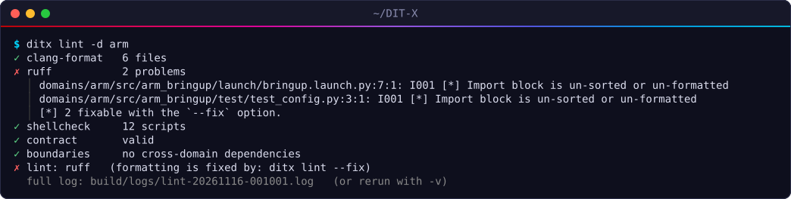

# 12 新增 domain

**目標**：新增 domain `arm`（機械手臂），完成從建立 repo 到通過整合測試的完整流程。

**時間**：約 30 分鐘

## 背景

一個 domain 對應一個 Git repo，也對應機器人上的一個容器。若要讓 DIT-X 識別新的 domain，需要修改下列位置：

| 位置 | 用途 |
|---|---|
| 新的 domain repo `Eurobot-Arm` | 原始碼；ROS 套件（package）放在 `src/` 下 |
| `ditx.repos` | 指定 `ditx sync` 要從哪裡複製（clone） |
| `<domain>_bringup` 套件 | **慣例**：容器啟動時執行 `ros2 launch arm_bringup bringup.launch.py` |
| `base/eurobot_common/contract.yaml` 的 `domains:` | 登錄 domain 名稱，啟動交握才會接受它 |
| `main_bringup/config/default.yaml` 的 `required_domains` | 決定 main 是否等待它就緒後才開始 |
| `docker/docker-bake.hcl` 的 `DOMAINS` | 讓 `ditx image` 與 CI 建置它的 runtime image |
| `docker/compose.yaml` | 機器人上的容器（參照 `vision` 區段撰寫） |
| `config/robots.ini` 的 `profiles` | 指定哪些機器人執行它 |

!!! note "請先討論"
    新增 domain 會修改 shell repo 與 `base/`，影響整個團隊。請先建立 issue，與 leads 討論職責劃分：這項功能是否適合放進現有的 domain？

## 前置條件

- 已完成 [11 修改共用介面](11-interfaces.md)
- 能在 repo 擁有者的帳號下建立 repo（目前是 `SeanChangX`；沒有權限時，請擁有者代為建立並邀請你）

## 步驟

### 1. 建立 repo

```bash
gh repo create SeanChangX/Eurobot-Arm --private --clone
cd Eurobot-Arm
git switch -c develop
```

從現有的 domain 複製下列檔案並修改內容：`.gitignore`、`CODEOWNERS`、`README.md`、`.github/workflows/ci.yml`（只需將 `domain: vision` 改為 `domain: arm`）。提交後推送 `develop` 分支。

### 2. 加入 `ditx.repos`

```yaml
  domains/arm:
    type: git
    url: https://github.com/SeanChangX/Eurobot-Arm.git
    version: develop
```

```bash
ditx sync
```


### 3. 建立第一個套件與 bringup

```bash
ditx new arm arm_gripper --lang python
```


建立 `arm_bringup` 最簡單的方式是複製 `vision_bringup`，再取代其中的 `vision` 與 `rival`：

```bash
cp -r domains/vision/src/vision_bringup domains/arm/src/arm_bringup
cd domains/arm/src/arm_bringup
mv vision_bringup arm_bringup
mv resource/vision_bringup resource/arm_bringup
grep -rl -e vision -e rival . | xargs sed -i \
  's/vision_rival/arm_gripper/g; s/rival_node/gripper_node/g; s/vision/arm/g; s/rival/gripper/g'
printf 'gripper:\n  ros__parameters:\n    rate_hz: 10.0\n' > config/default.yaml
ditx cd
```

### 4. 建置、測試與 lint

```bash
ditx build -d arm
ditx test -d arm
ditx lint -d arm
```




重新命名後 import 的排序改變了，執行 `ditx lint --fix -d arm` 即可自動修正。

### 5. 登錄至啟動交握

在 `main_bringup/config/default.yaml` 中將 `arm` 加入 `required_domains`，然後執行整合測試：

```bash
ditx test --integration
```


錯誤訊息會指出缺少的設定。在 `base/eurobot_common/contract.yaml` 中加入：

```yaml
domains: [main, navigation, localization, vision, arm]
```

由於修改了 `base/`，請依照 [11](11-interfaces.md) 的流程操作：

```bash
ditx build --base && ditx build
ditx test --integration
```


### 6. image 與機器人

1. `docker/docker-bake.hcl`：在 `DOMAINS` 加入 `arm`。
2. `docker/compose.yaml`：複製 `vision:` 區段並改為 `arm`（`profiles: [arm]`、`EUROBOT_CONTAINER: arm`，image `eurobot-arm`）。
3. `.github/workflows/ghcr-cleanup.yml`：在 `packages` 加入 `eurobot-arm`，CI 發佈的舊版本才會被定期清理。
4. 執行 `ditx image`，建置出 `eurobot-arm:local`。
5. `config/robots.ini`：在需要執行機械手臂的機器人的 `profiles` 加入 `arm`。

以上都屬於 shell repo 的修改，請與 `contract.yaml` 的變更合併為一個 PR 送出（`feat(base)!: add the arm domain`）。

## 摘要

- 一個 domain 由 repo、`ditx.repos` 中的一筆項目，以及 `<domain>_bringup` 組成。
- 讓系統接受新 domain：設定 `contract.yaml` 的 `domains` 與 main 的 `required_domains`。
- 讓新 domain 在機器人上執行：設定 bake 的 `DOMAINS`、`compose.yaml` 與 `robots.ini` 的 `profiles`。

## 下一步

[13 撰寫 plugin](13-plugins.md)
