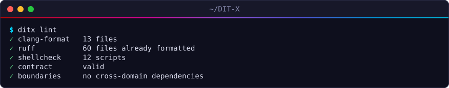

# 02 第一次建置與測試

**目標**：取得各 domain 的程式碼，完成建置，並執行單元測試與整合測試。

**時間**：約 20 分鐘（首次執行需建置 image）

## 背景

DIT-X 由「shell repo」與「domain repo」組成：

- **shell repo**：即 `DIT-X`，包含 `ditx` 工具、CI、Docker image，以及各小組共用的介面定義（`base/`）
- **domain repo**：每個小組各有一個 repo（`Eurobot-Main`、`Eurobot-Navigation`、`Eurobot-Localization`、`Eurobot-Vision`），列於 `ditx.repos`，`ditx sync` 會將它們放到 `domains/<組名>/`

建置在 **dev container** 中進行，每個 domain 各自擁有一層 install（`build/<distro>-<arch>/<domain>/install`）。因此，某個小組的程式出錯時不會影響其他小組，重新建置時也只會編譯有變更的部分。

## 前置條件

- 完成 [01 安裝](01-install.md)

## 步驟

### 1. 取得程式碼

```bash
ditx sync
```


`sync` 會先將 shell repo 快轉（fast-forward）至最新版本，再複製（clone）或快轉每個 domain repo，並安裝 Git hook（用於檢查提交訊息格式）。含有未提交變更的 repo 不會被更動。

`ditx.repos` 中的網址是 https（CI 與機器人以唯讀 token 讀取）；若 shell repo 是用 SSH clone 的，`sync` 也會用 SSH clone domain repo，因此同一把 SSH 金鑰就能 push 每個 repo，不需要另外設定。

!!! tip "只需要自己小組的程式碼"
    可以只取特定 domain，例如 `ditx sync vision`。之後 `build`、`test`、`lint`、`deploy` 預設只處理已同步的 domain，其他小組的程式碼不必下載。

    唯一的例外是整合測試（`ditx test --integration`）：它會同時啟動所有 domain，因此需要先執行完整的 `ditx sync`。

查看各 repo 目前的狀態，以及各 domain 包含哪些套件（package）：

```bash
ditx status
ditx list
```


### 2. 準備 image

image 可以在你的電腦上建置，第一次約需 5–10 分鐘，之後只有 Dockerfile 或相依套件改變時才需要重建：

```bash
ditx image          # 建 base、dev、cross 與 4 個 domain 的 runtime image（tag: local）
```

!!! tip "不想在本機建置"
    CI 會把 `develop` 的 image 發佈到 GHCR。在 `.env` 設定 `DIT_DEV_TAG=develop`，`ditx build` 就會直接 pull dev image，不必執行 `ditx image`。修改 Dockerfile 或相依套件時，仍需改回 `local` 並在本機建置。

```text
▸ images  humble · linux/amd64 → ghcr.io/seanchangx/eurobot-*:local
✓ images         base, dev, navigation, vision, localization, main  (loaded, 70 steps)  91s
```

!!! note "image 的用途"
    - **dev**：`ditx build`、`test`、`lint` 在裡面執行，VS Code 的 Dev Container 也用它。
    - **cross**：`ditx build --arch arm64` 用來交叉編譯。
    - **runtime**（每個 domain 一個）：`sim` 機器人執行的 image。

### 3. 格式檢查、建置與測試

```bash
ditx lint
ditx build
ditx test --integration
```




每個步驟顯示為一行。執行期間，左側會顯示進度指示符號，右側顯示目前的動作；完成後會變為 ✓ 或 ✗。

- **`-j auto`（預設）**：依據你的 RAM 與 CPU，決定同時建置的套件數量及每個 make 的 job 數，並將容器記憶體上限設為 80%，避免大型建置因記憶體不足（OOM）導致桌面工作階段終止
- **`--integration`**：同時啟動 4 個 domain，確認「啟動交握（handshake）」完成，且實際執行中的 topic
  與 `contract.yaml` 一致（名稱、型別相符，且每個 topic 都有 publisher）

### 4. 查看詳細輸出

`ditx` 會將 colcon、Docker 等工具的完整輸出儲存在 `build/logs/`，畫面上只顯示一行摘要。執行失敗時，會列出相關錯誤與日誌檔路徑。若要查看完整輸出：

```bash
ditx build -v          # verbose：完整輸出
ditx -n build          # dry-run：只印出會執行的指令，不真的做
```

## 摘要

- 使用 `ditx sync` 取得程式碼，使用 `ditx status` / `ditx list` 查看狀態
- `ditx build` 為每個 domain 建立獨立的 install 層，並進行增量建置
- `ditx test --integration` 是同時啟動所有 domain 的系統測試，CI 也會執行相同的測試

## 下一步

[03 認識 TUI](03-tui.md)：不需記憶指令，只要輸入 `ditx` 即可開始操作。
