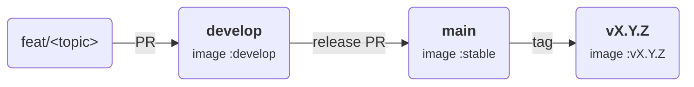

# 09 Git 流程與 CI

**目標**：依照團隊流程將一項修改合併至 `develop`：建立分支 → 以 Conventional Commits 提交 → 開啟 PR → 通過 CI → 審查（review）→ 合併（merge）。

**時間**：約 15 分鐘

## 背景



- **`develop`**：日常整合分支。測試用的機器人從這個分支建置 `:develop` image。
- **`main`**：比賽用分支。從 `develop` 開啟 release PR 合併；比賽用的機器人從這個分支建置 `:stable` image。
- **tag `vX.Y.Z`**：正式發行版本。在 release commit 上固定 `ditx.repos` 中的版本；shell repo 的 tag 加上該檔案，即構成整台機器人的完整軟體。
  版本號遵循 [SemVer](https://semver.org)，由上一版之後的 Conventional Commits 決定：有 `!`（破壞相容）升主版號，有 `feat` 升次版號，只有 `fix` 升修補版號。第一版是 `v0.1.0`；`0.x` 代表介面仍可能變動，跑完一整個賽季且介面穩定後再發 `v1.0.0`。賽季寫在 release 標題，例如「v1.2.0 — Eurobot 2027 決賽版」。

每個 domain 都是獨立的 domain repo，例如 `Eurobot-Main`、`Eurobot-Vision` 等，但 CI 邏輯全部集中在 shell repo：domain repo 的 `.github/workflows/ci.yml` 只有一行 `uses: SeanChangX/DIT-X/.github/workflows/domain-ci.yml@develop`，因此所有 domain 都使用相同的檢查方式。

## 前置條件

- 已完成 [04 第一個套件](../beginner/04-first-package.md)，且有一項準備提交的修改。
- 具備 GitHub 上該 domain repo 的寫入權限。

## 步驟

### 1. 從 develop 建立分支

```bash
ditx sync                 # 先把 develop 更新到最新
ditx cd vision
git switch -c feat/hello-node
```

分支命名方式為 `feat/…`、`fix/…`、`docs/…`，與提交訊息的 type 一致。

### 2. 提交：Conventional Commits

格式為 `type(scope): subject`。subject 最多 100 個字元，並使用祈使語氣（例如 add，而非 added）：

| type | 用途 |
|---|---|
| `feat` | 新功能 |
| `fix` | 修正錯誤 |
| `docs` | 僅修改文件 |
| `refactor` / `perf` / `test` | 重構、效能、測試 |
| `build` / `ci` / `chore` | 建置、CI、雜項 |

scope 通常是 domain 或模組範圍：`main`、`navigation`、`localization`、`vision`、`base`、`tools`、`docker`、`ci`。若修改會破壞相容性，請在 type 後加上 `!`，例如 `feat(base)!: rename pose topic`。

`ditx sync` 已在每個 repo 安裝 `commit-msg` hook，格式不符的提交會直接遭到拒絕：

```bash
git commit -am "update readme"
```


```bash
git commit -am "feat(vision): publish hello topic"
```

!!! tip "提交訊息範本"
    在 shell repo 執行一次 `git config commit.template .gitmessage`。之後執行 `git commit`（不加 `-m`）時，會開啟一份附有格式說明的範本，提醒你說明**修改原因**與**測試方式**。

### 3. 推送前先在本機執行 CI

```bash
ditx ci lint
ditx ci build
ditx ci test
```

`ditx ci <stage>` 與 GitHub Actions 執行的是**同一段程式**；在本機通過，CI 上也會通過。格式問題可使用 `ditx lint --fix` 自動修正。

### 4. 推送並開啟 PR

```bash
git push -u origin feat/hello-node
gh pr create --base develop --fill
```

PR 會自動套用範本，請依序填寫：

- **What / Why**：修改內容，以及要解決的問題（`Closes #123`）。
- **How it was tested**：`ditx test`、`ditx test --integration`，以及在 sim 或實體機器人上的 overlay id。
- **Interfaces changed?**：是否修改了 `contract.yaml` / `.msg`（請參閱 [11](../advanced/11-interfaces.md)）。
- **Risk / rollback**

**PR 標題也必須符合 Conventional Commits**：PR 採用 squash merge，其標題即為最終進入 `develop` 的 commit 訊息。

### 5. 通過 CI 後再請求審查

CI 依序執行：PR 標題檢查 → `lint` → `build-test`（Humble 必須通過；Jazzy 允許失敗）。**CI 通過之前不會進行審查。**審查者由 `CODEOWNERS` 自動指定。

### 6. 合併之後

合併到 `develop` 或 `main` 後，CI 會在檢查通過後把 image 發佈到 GHCR（`:develop`、`:stable`）。要讓機器人執行新版本，執行 `ditx up -r <robot> --pull` 即可（見 [14](../advanced/14-real-robot.md) 第 3 步）。

## 摘要

- 從 `develop` 建立分支，提交訊息與 PR 標題皆須遵循 Conventional Commits。
- `ditx ci lint/build/test` 與雲端 CI 相同，推送前請先在本機執行。
- CI 通過 → 審查 → squash merge → 在機器人上重新建置 image。

## 下一步

[10 管理機器人](10-robots.md)
