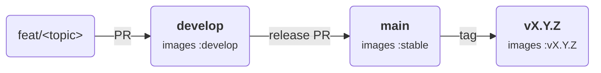

# Daily workflow

Every command below also exists in the TUI (`ditx` with no arguments), which shows the exact
command line before running it.

## Develop

```bash
ditx sync                       # clone / fast-forward all domains (ditx.repos)
ditx build -d localization      # incremental build in the dev container
ditx test  -d localization      # unit tests (colcon test)
ditx test  --integration        # all domains together: handshake + contract check
ditx lint  --fix                # format; CI runs `ditx lint` without --fix
ditx index                      # compile_commands.json for clangd (Ctrl+click works)
ditx shell                      # a shell in the dev container, everything sourced
```

* Builds run in `eurobot-dev` with the workspace mounted at **the same path**. Paths in errors,
  test reports and `compile_commands.json` therefore work on the host.
* `-j auto` (the default) picks `colcon workers × make -j` from your RAM and caps the container
  at 80% of it. A big build can no longer OOM-kill your desktop session. The machine stays usable, and in the worst
  case only the build dies.
* ccache is kept in the `eurobot-ccache` docker volume, so rebuilding after `ditx clean` is fast.

## Try it on a robot

```bash
ditx deploy -d localization -r white          # build → overlay → restart → verify
ditx overlays -r white                        # who pushed what, from which commit
ditx logs -r white -d localization -f
ditx rollback -d localization -r white        # back to the stable image
```

* What gets pushed is your **build output only** (`install/`) plus a manifest. The robot never
  sees source and never compiles.
* If the container does not come up healthy, deploy **rolls back automatically**
  (`--no-rollback` keeps it for debugging).
* An overlay is gone after a **reboot** (back to the image CI built) unless you pass
  `--persist`. Match day therefore always starts from something reproducible.
* `-r sim` runs the same thing on your laptop: everything under `.sim-robot/`, no robot needed.
  It needs runtime images: `ditx image` builds them locally with tag `local`.

## Merge and release



1. Branch from `develop`, commit with [Conventional Commits](https://www.conventionalcommits.org/)
   (`feat(localization): fuse lidar beacons`). The `commit-msg` hook checks it
   (`pre-commit install --hook-type commit-msg`).
2. Open a PR. CI runs lint → build → test, then starts the robot stack the way a robot runs it
   (runtime images, subnet discovery, a uid without a home) and checks it against the contract.
   Review starts only when it is green.
3. Merging to `develop` makes it the source of `:develop` images, which test robots build and run.
4. A release PR `develop → main` is what `:stable` is built from. Competition robots run
   `tag = stable` (or a pinned `vX.Y.Z`) from `config/robots.ini`.
   After the checks pass, CI publishes the images to GHCR (`:develop`, `:stable`,
   `:vX.Y.Z`, amd64 + arm64), so `ditx up -r white --pull` updates a robot. A version that is
   not published (a feature branch) is built on the robot instead (tutorial 14).
   A weekly job (`ghcr-cleanup.yml`) keeps `develop`, `stable`, every `vX.Y.Z` and the 10 newest
   `sha-*` tags per image, and deletes the rest.
5. Pin the domain versions in `ditx.repos` on the release commit. Shell tag + that file
   = the whole robot software, reproducible.

## When you change an interface

`base/` (msgs, srvs, `contract.yaml`) is shared by everyone:

1. Edit it, then run `ditx build --base` (a local base layer) and `ditx build` (every domain on top).
2. `ditx test --integration`. `ditx contract md` regenerates `docs/contract.md`.
3. PR to the shell, reviewed by the code owners (`.github/CODEOWNERS`).
4. After merge, domains rebuild against the new base, and robots rebuild their images
   (tutorial 14, step 3). Overlays built against the old base are refused with a clear message.
